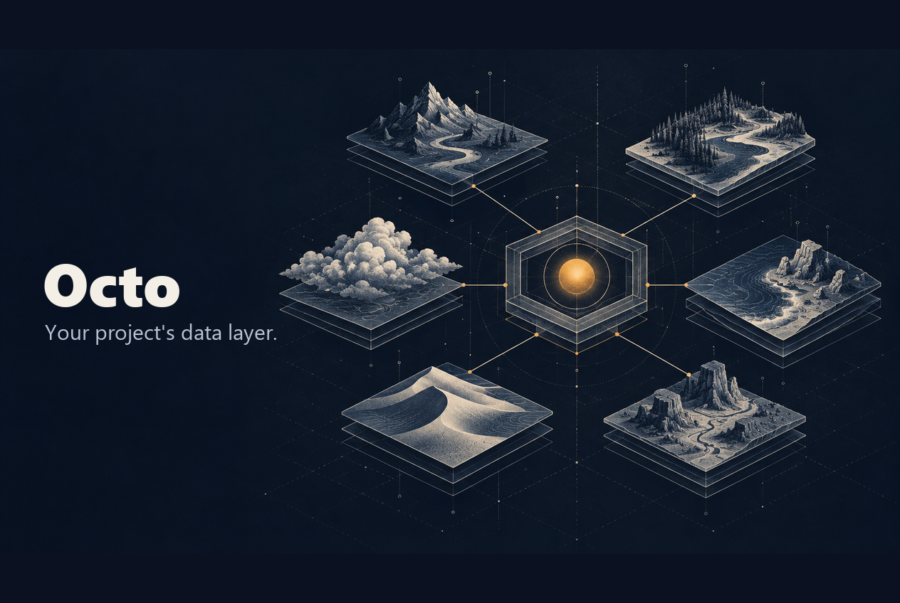

# Octo

Octo is a self-hosted workspace data platform. One server gives every project,
person, and agent a workspace with its own database, files, analytics, retrieval,
graph, and credentials — reached through one capability API instead of rebuilt
plumbing.



---

## Why this exists

Personal files, family media, work projects, research systems, and AI agents end
up scattered across local disks and unrelated services. Octo gives them one
durable identity and workspace boundary while keeping the underlying
infrastructure replaceable.

- **PostgreSQL + pgvector** — canonical metadata, workspace membership, optional
  vector search, and fail-closed Row-Level Security.
- **A database per workspace** — provisioned at creation and owned by its own
  scoped role, reachable with an Octo key and no connection string.
- **Cloudflare R2** — hot object storage, plus a public bucket for published files.
- **Google Drive** — cold archival tier for files that leave active storage.
- **FalkorDB** — an optional, rebuildable graph projection over the epistemic ledger.
- **DuckDB + Parquet** — immutable dataset versions and named analytical queries.
- **One Platform API and scoped agent keys** — users and autonomous agents work
  with logical IDs and workspace machine tokens. Master database and cloud
  credentials stay on the server.

> **Building a project that Octo serves?** Octo is that project's data layer. Do
> not stand up a database of your own — provision the workspace database through
> Octo, then run SQL with your Octo API key or connect with an ordinary Postgres
> client. A human mints the project's workspace-scoped key once (creating a
> workspace and minting a key are human-stamped; an API key can never do either).
> See **[docs/consuming-octo.md](docs/consuming-octo.md)**.

---

## What ships today

| Capability | What it does |
|---|---|
| **Workspaces and identity** | Google OAuth or guest sign-in, principals, roles (`member`/`operator`/`admin`), per-workspace membership, RLS-backed isolation |
| **Provisioned databases** | Each workspace gets its own PostgreSQL database and scoped role at creation; reach it by connection string (returned once) or the SQL surface |
| **SQL surface** | `POST /api/workspaces/<id>/query` runs SQL with just an API key — no host, port, or connection string |
| **Files** | Upload, list, download, delete, thumbnails, and short-lived signed URLs, backed by R2 |
| **Publishing** | Copy one file to the public bucket and get a stable HTTPS URL; unpublish reverses it |
| **Archival** | Move files to Google Drive cold storage and restore them on demand |
| **Gallery and shares** | Image and video gallery with thumbnails, plus scoped public share links |
| **Analytics** | Register immutable Parquet dataset versions, run named query specs through DuckDB, fetch result artifacts |
| **Retrieval** | Ingest documents, chunk and embed them locally, then query by similarity |
| **Epistemic ledger** | Bitemporal claims, beliefs, and evidence with as-of queries; a correction is a new row, never a rewrite |
| **Graph** | Rebuildable FalkorDB projection of the ledger, with health reporting and read-only Cypher queries |
| **Jobs and operations** | Background job queue plus classified operational failure events and summaries |
| **Credential vault** | Store credentials, mint leases, and relay working keys to vendor APIs without handing plaintext to an agent |
| **API keys** | Account-wide or workspace-scoped keys over four real scopes, named key classes, MFA step-up, and a human confirmation gate on creation |
| **MCP server** | 29 tools over Streamable HTTP at `/mcp`, with OAuth 2.1 authorization for hosted clients |
| **Control dashboard** | Overview, files, gallery, analytics, operations, access, and vault views, with switchable design systems |

Capability discovery is live: `GET /api/capabilities` returns the actions,
methods, paths, and required scopes available to the calling credential, minus
anything its provider configuration cannot serve.

---

## Surfaces

| Surface | How to reach it |
|---|---|
| **HTTP API** | `https://<host>/api/...` with `Authorization: Bearer octo_live_...` |
| **MCP** | `POST /mcp` (Streamable HTTP); bearer key or OAuth access token |
| **SQL** | `POST /api/workspaces/<id>/query`, or a direct Postgres connection from the provisioning call |
| **Web UI** | The dashboard served at the site root |

The API and the MCP server expose the same capabilities; the UI is a client of
the API.

---

## Deploying and running

Octo runs as Docker Compose: a Caddy frontend, a Node API, PostgreSQL with
pgvector, and FalkorDB, with an optional Cloudflare Tunnel connector. The live
instance runs on macOS under launchd agents that poll `origin/production` and
deploy on change, with scheduled database and file backups.

- Deployment and promotion runbook: **[docs/self-hosting.md](docs/self-hosting.md)**
  (the Compose topology and promotion flow; host-specific scripts live in `deploy/mac/`)
- Architecture and enforced repository shape: **[docs/ARCHITECTURE.md](docs/ARCHITECTURE.md)**
- Consuming Octo from a project: **[docs/consuming-octo.md](docs/consuming-octo.md)**

---

## Managed folder backup

Back up your **Desktop** and **Downloads** folders into one workspace, foldered by
source and incremental on re-run. It never touches your local files and stores no
credentials. See **[docs/backup.md](docs/backup.md)** for the three-step start
(get a key, set two variables, run), configuration, and a daily schedule.

```bash
npm run backup -- --dry-run   # preview what would upload
npm run backup -- --commit    # upload changed files
```

---

## Repository operational capture

Point a workspace at this repository to collect operational snapshots — git
state, repository shape, test inventory, and live server health — as JSON files
you can browse and analyze alongside other workspace data. Read-only against the
repository and the server; the only write is the snapshot upload.

```bash
OCTO_OPS_TOKEN=octo_live_ws_... OCTO_OPS_WORKSPACE=<uuid> npm run capture-ops
OCTO_OPS_TOKEN=... OCTO_OPS_WORKSPACE=... npm run capture-ops -- --dry-run
```

---

## Local development and gates

The root and the frontend app have separate dependency trees.

```bash
npm install
npm ci --prefix frontend

npm run server            # API on :3001
npm run dev               # frontend on :3000, proxying the API

npm run typecheck         # TypeScript
npm run lint:imports      # dependency-cruiser layer rule
npm test                  # Vitest unit and integration tests

python scripts/check_json.py
python -m unittest discover -s tests -v
ruff check scripts tests
ruff format --check scripts tests
mypy

npx playwright test       # browser suite; needs a running stack
```

CI runs all of the above as the single required `gates` check, along with the
live isolation, provisioning, SQL-surface, and analytics verifiers in `scripts/`.

---

## Repository shape

Octo is a modular monolith organized by feature. `src/routes/<family>.ts` owns one
HTTP route family; `src/server/` holds the composition root, shared request
plumbing, and the SQL stores; `src/<domain>/` holds slice services; `src/lib/` and
`src/types/` are leaves.

The layer rule is machine-checked, not advisory: `npm run lint:imports` fails CI
on an import that crosses a boundary the wrong way. The full tree and rationale
are in **[docs/ARCHITECTURE.md](docs/ARCHITECTURE.md)**.
